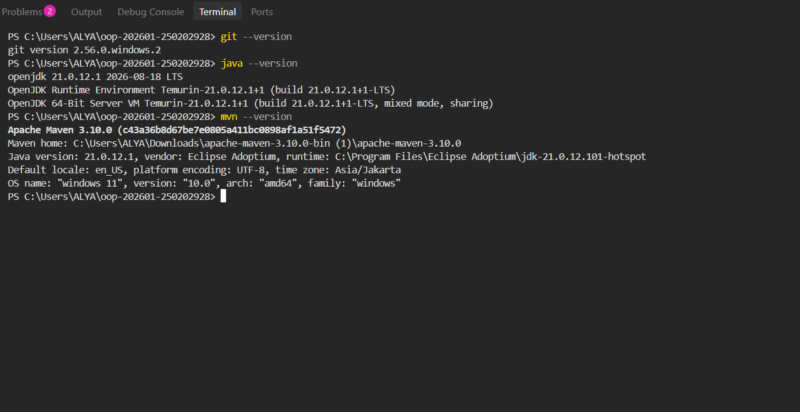
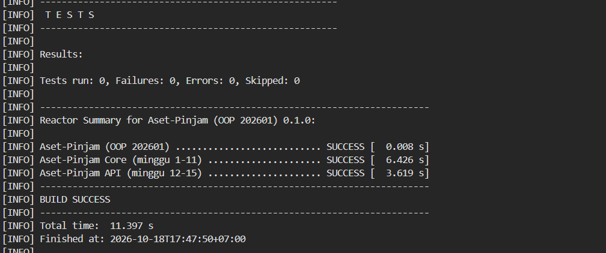
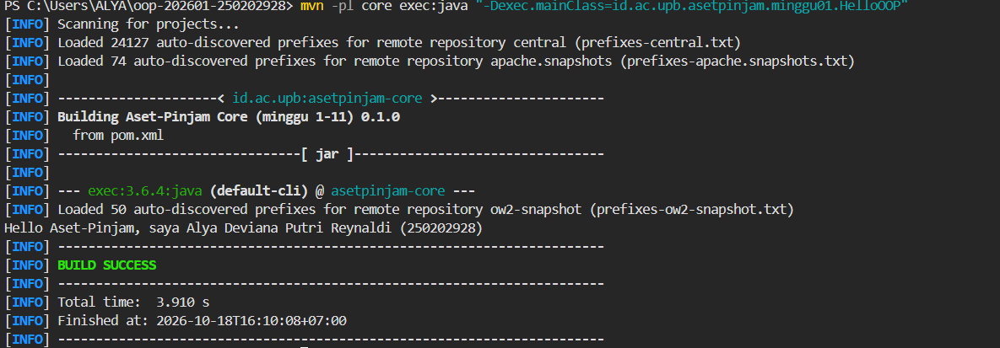

Catatan Minggu 1

## Yang saya kerjakan
Saya mengerjakan tiga contoh program sederhana menggunakan paradigma prosedural, OOP, dan fungsional, yaitu melengkapi kode yang masih TODO pada file "HelloProsedural.java", "HelloOOP.java", dan "HelloFungsional.java" lalu menjalankan tes untuk melihat hasil output.

## Keputusan Desain
Untuk Program Prosedural, menggunakan statis sapa untuk menghasilkan sapaan menggunakan nama dan NIM.

Untuk OOP, menggunakan atribut nama dan nim serta sapa dalam HelloOOP.

Untuk Fungsional, menggunakan Function String, String, serta Lambda

Ketiganya, menghasilkan sapaan yang sama tetapi dengan pendekatan pemrograman berbeda.

## Kendala
Kendalanya pada saat menjalankan melalui terminal karena Maven tidak terdeteksi saat pertama kali digunakan dan juga menentukan kode yang sesuai dengan ketentuan.

Saya mengatasinya dengan memeriksa dan menjalankan tes kembali beberapa kali.

## Penggunaan AI
- Alat yang dipakai: 

   ChatGPT, Claude

- Bagian yang dibantu AI:

  Panduan menjalankan program, Memperbaiki Maven yang tidak terdeteksi

- Prompt Utama:

  Bagaimana cara mengatasi Maven yang tidak terdeteksi di terminal Windows?

  Jelaskan tentang perbedaan paradigma prosedural, OOP, dan fungsional dalam program Java, beserta panduan uji.

- Yang saya ubah atau tolak dari saran AI, dan alasannya: 

  Tidak ada

- Satu hal yang saya pahami lebih baik sekarang:

  Saya memahami cara menjalankan program dan mengetahui ada perbedaan di paradigma prosedural, OOP, dan fungsional.

